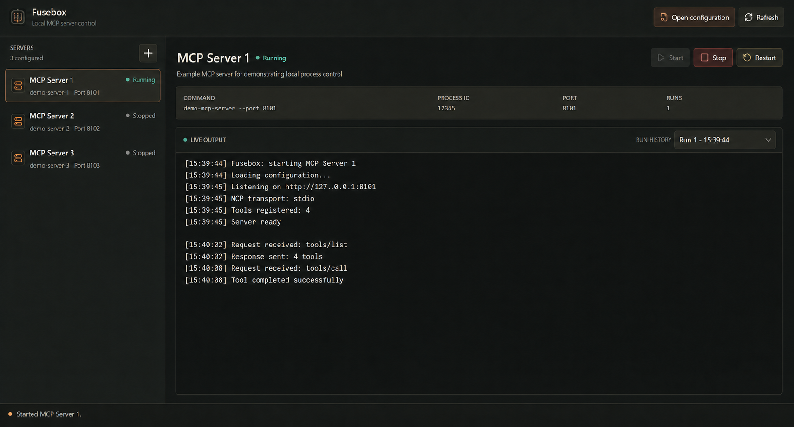

# Fusebox

Fusebox is a desktop application for starting, stopping, and inspecting local MCP
server processes without keeping a separate terminal window open for each one. It
provides an externally editable server catalog, process lifecycle controls, live
output grouped by run, configuration error handling, and safe shutdown prompts.



## Download

Download the latest self-contained Windows 64-bit executable from
[GitHub Releases](https://github.com/ThomasvHoutum/Fusebox/releases/latest).
The release build does not require a separate .NET installation.

Prebuilt macOS packages are not currently published. To use Fusebox on macOS,
[build it from source](#build-from-source).

## Get started

1. Start Fusebox.
2. Select **Open configuration**. On its first run, Fusebox creates `servers.json`
   in the current user's local application-data directory.
3. Add a server definition and save the file.
4. Return to Fusebox and select **Refresh**.
5. Select the server and press **Start**.

## Configure servers

Entries live under a `servers` object and use a stable, human-readable key:

```json
{
  "servers": {
    "example-mcp": {
      "title": "Example MCP",
      "description": "A locally hosted MCP server",
      "command": "path-to-command",
      "args": ["--serve"],
      "env": {
        "EXAMPLE_API_KEY": "replace-me"
      },
      "port": 3000
    }
  }
}
```

| Field | Required | Type | Default | Purpose |
| --- | --- | --- | --- | --- |
| Server key | Yes | String | — | Stable identifier for the entry. |
| `command` | Yes | String | — | Executable name, executable path, or complete command line. |
| `title` | No | String | Server key | Display name. |
| `description` | No | String | Empty | Display description. |
| `args` | No | Array of strings | Empty | Arguments passed directly to the executable. |
| `env` | No | Object of string values | Empty | Environment variables added to the child process. |
| `port` | No | Integer from 1 to 65535 | None | Display-only port label; Fusebox does not bind, probe, or validate it. |

Using `args` for arguments is preferred because it avoids quoting ambiguity.
Executable names registered globally can be used without a path; Fusebox inherits
the user's `PATH` in both development and published builds.

Paths containing spaces are supported. When a complete command line starts with
such a path, quote it, for example:

```json
{
  "command": "\"C:\\Program Files\\Example MCP\\server.exe\" --serve"
}
```

Commands are parsed directly and are not run through a shell, so shell operators
such as `&&`, pipes, and output redirection are not supported.

After saving the file, select **Refresh**. Changes to a running entry apply on its
next restart. Start and Restart reread the file before launching, and Restart
validates the newest definition before stopping the existing process.

Environment values are stored as plaintext. Keep the configuration file out of
source control, shared folders, and inappropriate backups.

## MCP transport compatibility

Fusebox supervises local processes and captures their standard output and error. It
does not act as an MCP client or proxy, and it does not connect a process's standard
input and output to an MCP client.

Fusebox is therefore best suited to long-running MCP servers that expose a network
transport, such as Streamable HTTP or SSE. An MCP server that uses the stdio
transport should normally be launched directly by the MCP client that communicates
with it.

## Current scope

- Run one managed process per configured entry, with multiple entries running
  concurrently.
- Start, stop, and restart managed processes.
- Show Stopped, Starting, Running, Stopping, and Failed process states.
- Keep output in separate runs for the current application session.
- Preserve the last successfully loaded catalog when the JSON file is unreadable.
- Stop managed processes when the application closes, with confirmation and
  force-quit escalation.

Fusebox does not install MCP servers, configure MCP clients, discover external
processes, validate MCP readiness, or persist logs.

## Build from source

Building Fusebox requires the .NET 10 SDK. Windows is the primary platform; macOS
is a validation target.

```shell
dotnet restore Fusebox.sln
dotnet run --project src/Fusebox/Fusebox.csproj
```

See [Contributing](CONTRIBUTING.md) for Release builds, distribution publishing,
and the project architecture.

## Project links

- [Releases](https://github.com/ThomasvHoutum/Fusebox/releases)
- [Contributing](CONTRIBUTING.md)
- [Security policy](SECURITY.md)
- [Report an issue](https://github.com/ThomasvHoutum/Fusebox/issues/new)

## License

Fusebox is available under the [MIT License](LICENSE).
